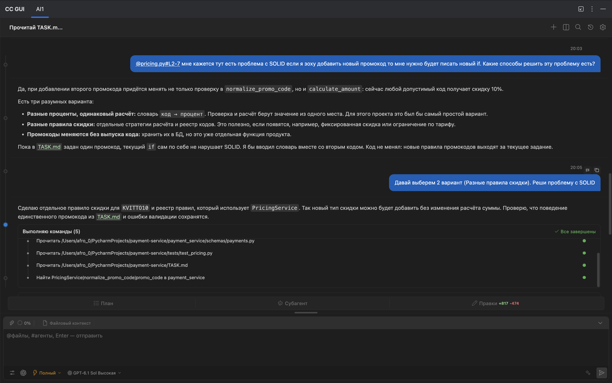

# Использование ИИ

## Инструменты и модель

- **Codex** — помощь в реализации и обсуждении архитектуры сервиса.
- **Ponytail** — скил для выбора минимального решения в рамках `TASK.md` и проверки, что изменение доведено до затронутых тестов и вызовов.
- **FastAPI Templates** (`fastapi-templates`) — скил для первоначального каркаса FastAPI-приложения.

## Слабое решение и моя проверка

В первоначальном варианте обработка промокода была привязана к обычным условиям. Я указал модели на этот сценарий и спросил, как расширять код с учётом (SOLID). Я выбрал предложенный ею второй вариант: отдельные стратегии расчёта и реестр промокодов.

